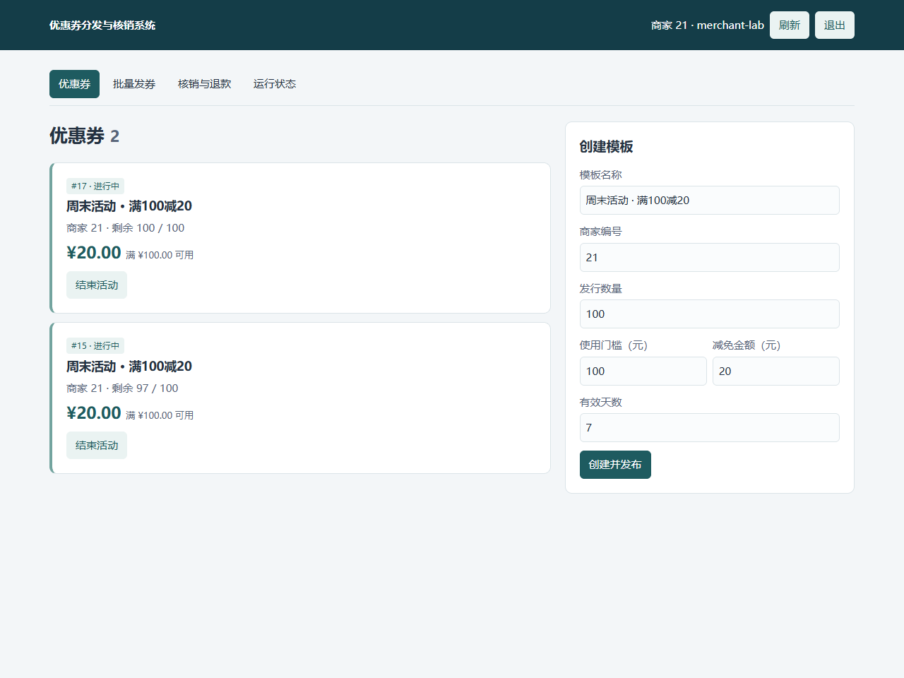

# 优惠券分发与核销系统

一个可运行的优惠券后端项目，覆盖商家建券、批量发券、用户领取、结算锁券、核销和退款。项目提供按角色区分的工作台、接口示例和自动化验证。

**技术栈** Java 17 · Spring Boot · Spring Cloud Gateway · Nacos · MySQL · ShardingSphere · Redis · Redisson · RabbitMQ · XXL-Job



## 核心设计

| 场景 | 实现 |
| --- | --- |
| 热点领券 | Redis Lua 原子预占，MySQL 事务和唯一约束负责最终发券，异步接口返回请求编号供查询 |
| 批量分发 | CSV、XLSX 按行读取，500 行一批提交检查点，租约到期后可续跑，任务保留失败记录 |
| 消息恢复 | Outbox 与业务同事务，发布确认、返回通知、Inbox 去重、提交后 ACK、延迟补偿和死信 |
| 结算和核销 | ZSet 与 Pipeline 读取券包，锁券、取消、核销、退券按订单校验，商家确认本店订单 |
| 身份和权限 | Spring Security、BCrypt、可撤销的短期 Bearer 会话，商家仅管理自己的模板和发券任务 |
| 数据路由 | 模板按商家号、用户券按用户号各分四张表，统一编号与全局订单唯一性保留在同一 MySQL 库 |

更多流程和约束见 [架构说明](docs/architecture.md) 与 [业务规格](docs/spec.md)。

## 本地运行

本地运行使用原生 MySQL、Redis、RabbitMQ，Java 17 和 Maven 3.9 可直接选用 IDEA 内置 Maven。

1. 启动原生服务。在 MySQL 建立业务库 `quanshu` 和仅供测试的 `quanshu_test`，并为专用应用账号授予这两个库的权限。在 RabbitMQ 创建 `quanshu` vhost，并为应用账号授予该 vhost 的权限。测试 Redis 使用数据库 15。
2. 复制 [application-local.properties.example](application-local.properties.example) 为根目录下的 `application-local.properties`，填写连接参数。
3. 复制 [accounts.example.json](examples/accounts.example.json) 为根目录下的 `accounts.json`，把示例密码改成独立随机密码。启动后账号以 BCrypt 散列保存，账号文件可移到项目外。应用再次启动时会保留已有账号。
4. 在 IDEA 导入根 `pom.xml`，选择 Java 17 和 Bundled Maven。只构建应用时运行 `package -DskipTests`，再从项目根目录启动引擎。

   ```bash
   java -jar engine/target/quanshu-engine-0.1.0.jar
   ```

5. 打开 [本机工作台](http://localhost:8080)。先用商家账号创建模板，再换用户账号领取并锁券，最后用商家账号按订单号查询、核销或退款。

也可在 IDEA 中运行 `cn.quanshu.QuanshuApplication`，工作目录选项目根目录，启用 `sharded` Spring Profile。连接使用端口转发时，按实际端口修改配置。分进程部署与迁移参见 [Ubuntu 部署说明](docs/ubuntu-deployment.md)。

## 验证

- `mvn verify` 或 IDEA 的 Maven **Lifecycle → verify** 执行真实 MySQL、Redis 和网关测试。设置 `TEST_DB_URL=jdbc:mysql://127.0.0.1:3306/quanshu_test?serverTimezone=UTC` 和 `TEST_REDIS_PORT=6379`，需要时替换实际端口。测试会清理 `quanshu_test` 和 Redis 15，公共 CI 使用独立服务。
- 将 [HTTP Client 私有环境示例](examples/http-client.private.env.example.json) 复制为项目根目录的 `http-client.private.env.json` 后填写账号，再在 IDEA 中执行 [requests.http](requests.http)。[examples/recipients.csv](examples/recipients.csv) 可用于试跑批量发券。
- [验收记录](docs/progress.md) 包含并发库存对账、Broker 中断恢复、真实 XLSX 5000 人批次、百万行 CSV 解析和 JMeter 压测口径。
- [简历项目说明](docs/resume-project.md) 说明可引用的实现、数字和场景限制。

当前部署使用同库分表与单节点中间件。商家核销流程由应用账号确认，外部支付回调与高可用部署仍待集成。CSV 流式解析已单独验证百万行，完整批量发券已验收 5000 人。
