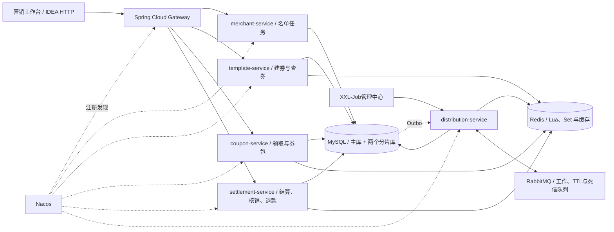

# 架构与关键边界

全部进程当前位于同一 Ubuntu VM。Gateway 按资源路径选择 Nacos 注册的服务，透传会话和查询参数。角色过滤器将业务接口限制在对应进程。

业务服务按角色运行，同一 engine 构件提供领域代码。进程共享主数据库与本机导入文件目录。

ShardingSphere 使用自定义 Hash，模板按商家编号路由，物理字段为 `shop_number`；用户券按 `user_id` 路由。主库内的可更新视图指向两个分片库里的物理 InnoDB 表，使模板库存、用户券、全局约束和 Outbox 可在同一 MySQL 实例内提交本地事务。只按模板 ID 查询时会遍历分片。

异步领取的成功以MySQL券提交为准。消费者先执行业务事务，再标记Outbox消费确认，最后ACK；确认丢失时可以重新投递，Inbox与业务约束避免重复发券。延迟队列中的SENT消息可能尚未到期，不能将所有SENT视为失败。

固定TTL队列分桶避免不同TTL在同一队列中产生队头阻塞；提前唤醒会安排剩余时间。状态处理核对数据库截止时间与订单归属，XXL扫描兜底。缓存与锁用于降低读压力及协调操作，数据库条件与事务仍是最终事实源。

版本与协议参考：[Spring Cloud Alibaba 2025.0.x](https://github.com/alibaba/spring-cloud-alibaba/tree/2025.0.x)、[ShardingSphere 5.5.3 Java API](https://shardingsphere.apache.org/document/5.5.3/en/user-manual/shardingsphere-jdbc/java-api/)、[RabbitMQ通用包部署](https://www.rabbitmq.com/docs/install-generic-unix)、[XXL-Job 3.1.1](https://github.com/xuxueli/xxl-job/tree/3.1.1)。XXL管理中心从该官方标签构建，源码归属及许可沿用上游。

## 账号与授权边界

登录只从服务端会话读取身份。密码使用 BCrypt，数据库保存随机令牌的 SHA-256 摘要及到期时间，主动退出删除会话。商家仅可读写本店模板、名单任务和订单券状态，用户身份由会话映射为用户编号。各业务进程使用同一会话表。

用户提交锁券，商家按订单号复核后确认核销和退款。系统当前承担券状态流转，订单系统与支付渠道尚未对接。

钱包缓存以版本号区分业务更新。缓存续期只有一个填充进程发布快照，读端校验完成标记记录的条目数。索引或详情不齐时会读取 MySQL。
