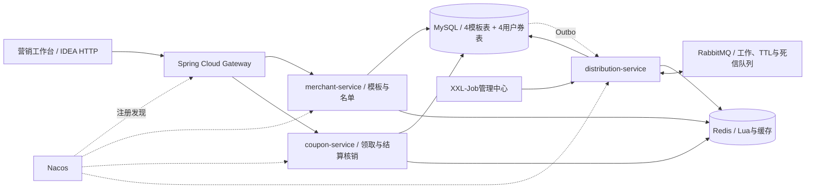

# 架构与关键边界

全部进程当前位于同一Ubuntu VM；Nacos负责发现，不承担业务数据存储。Gateway的商家路由优先于通用/api路由，用户标识和查询参数透传。角色过滤器避免商家进程接收用户券写接口，后台进程不接收业务API。

业务服务使用同一engine构件，按角色运行。模块拆分与部署拆分是两件事：此版本共享领域代码、数据库和文件目录，不承诺跨主机共享文件或每服务独占数据库。

ShardingSphere将逻辑模板与用户券映射到实际物理表。没有分片键的模板ID查询需要广播。全局ID、请求/订单唯一表和单数据源事务避免分片后唯一约束及本地事务失效；代价是中心约束表和热点模板库存仍有限制。

异步领取的成功以MySQL券提交为准。消费者先执行业务事务，再标记Outbox消费确认，最后ACK；确认丢失时可以重新投递，Inbox与业务约束避免重复发券。延迟队列中的SENT消息可能尚未到期，不能将所有SENT视为失败。

固定TTL队列分桶避免不同TTL在同一队列中产生队头阻塞；提前唤醒会安排剩余时间。状态处理核对数据库截止时间与订单归属，XXL扫描兜底。缓存与锁用于降低读压力及协调操作，数据库条件与事务仍是最终事实源。

版本与协议参考：[Spring Cloud Alibaba 2025.0.x](https://github.com/alibaba/spring-cloud-alibaba/tree/2025.0.x)、[ShardingSphere 5.5.3 Java API](https://shardingsphere.apache.org/document/5.5.3/en/user-manual/shardingsphere-jdbc/java-api/)、[RabbitMQ通用包部署](https://www.rabbitmq.com/docs/install-generic-unix)、[XXL-Job 3.1.1](https://github.com/xuxueli/xxl-job/tree/3.1.1)。XXL管理中心从该官方标签构建，源码归属及许可沿用上游。

## 账号与授权边界

登录只从服务端会话读取身份。密码使用 BCrypt，数据库保存随机令牌的 SHA-256 摘要及到期时间，主动退出删除会话。商家仅可读写本店模板、名单任务和订单券状态，用户身份由会话映射为用户编号。两个业务进程使用同一会话表，因此从网关切换路由时会话仍有效。

用户提交锁券，商家按订单号复核后确认核销和退款。系统当前承担券状态流转，订单系统与支付渠道尚未对接。

钱包缓存以版本号区分业务更新。缓存续期只有一个填充进程发布快照，读端校验完成标记记录的条目数。索引或详情不齐时会读取 MySQL。
